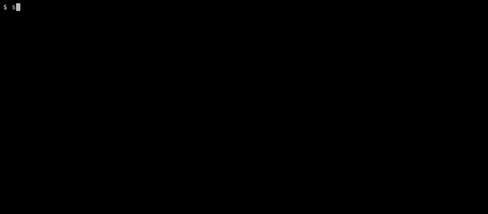
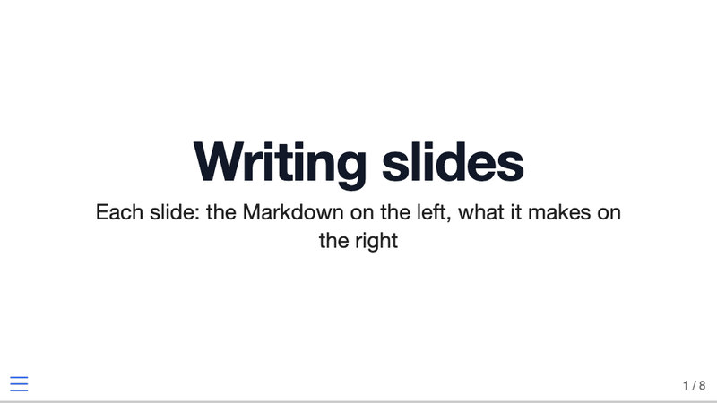

# slides

reveal.js decks written as Markdown with [Quarto](https://quarto.org): one
self-contained `.html` per deck, to present, mail or attach.

- `template.qmd`, `custom.scss`: what `slides new` copies into a new deck. The
  template is bare: a title and one slide to start writing on.
  install.sh links this folder to `~/.config/slides` (`$SLIDES_TEMPLATE_DIR`
  points `slides` elsewhere).
- `reference.qmd`: a lorem ipsum deck showing the features below (columns,
  tabs, fragments, tables, speaker notes), to copy from. `slides new` never
  copies it; open `~/.config/slides/reference.qmd`.
- `slides` (`.config/shell/bin/slides`): `new <dir>`, `edit`, `preview`,
  `render`, `pdf`. `slides help` says more.
- Vim: [vimoured/quarto-slides](https://github.com/vimoured/quarto-slides),
  bound in `vim-rc/after/ftplugin/quarto.vim`: `_p` toggles the live preview
  in a pane next to Vim (each `:w` reloads the browser), `_r` renders the
  `.html`, `_o` opens it.

Needs quarto: `brew install --cask quarto`. Optional: `npx` (Node.js) for
`slides pdf`.

```sh
slides new 2026-12-lorem    # 2026-12-lorem/slides.qmd + custom.scss
cd 2026-12-lorem && slides edit
```



`slides new` makes the deck, `slides edit` opens it in Vim on its first slide.
`_p` starts `quarto preview` in the pane on the right, and it opens the deck in
the browser (not in the GIF); each `:w` re-renders and reloads it. `_r` writes
`slides.html` next to `slides.qmd`: that file is the deck to present or send.

## Where the title slide comes from

From `title:` in the front matter, the block between the `---` lines at the
top. With `subtitle:`, `author:` and `date:`, Quarto makes the first slide
from it. Neither the file name nor a `#` heading has anything to do with it:

- The file name only names the output: `slides.qmd` renders to `slides.html`.
  Every deck can be `slides.qmd`; the folder (`2026-12-lorem`) tells them apart.
- `# Title` makes a section slide: a heading alone on a slide, to divide the
  deck into parts. `## Title` makes an ordinary slide.

## Writing slides: cheat sheet

Each slide of this GIF shows the Markdown on the left and what it makes on the
right, step by step as a click would show it:



| Markdown | Result |
| --- | --- |
| `# Title` | Section title slide |
| `## Title` | New slide |
| `::: {.incremental}` … `:::` | Bullets appear one at a time |
| `. . .` | Pause: what follows appears on the next click |
| `:::: {.columns}` + `::: {.column width="50%"}` | Columns |
| `::: {.panel-tabset}` + `### Tab` | Tabs |
| `::: {.notes}` | Speaker notes (press `s` while presenting) |
| ```` ```{.python code-line-numbers="2-3"} ```` | Highlight code lines |
| `## Title {background-color="#e0f2fe"}` | Slide background |

While presenting: `f` full screen, `o` or `Esc` slide overview, `s` speaker
view, `?` all keys.

**Theme:** edit `custom.scss` next to the deck, or change `theme:` in the
header (`[moon, custom.scss]`, `[simple, custom.scss]`, …). See
[the list of themes](https://quarto.org/docs/presentations/revealjs/themes.html).

**PDF:** `slides pdf` uses decktape. Or open the deck in Chrome with
`?print-pdf` added to the URL and print to PDF
([reveal.js PDF export](https://revealjs.com/pdf-export/)).

## The GIFs

`docs/demo/record.sh` records them: `deck.gif` with quarto, Chrome and ffmpeg,
`workflow.gif` with [VHS](https://github.com/charmbracelet/vhs), tmux and
quarto-slides.

## References

- <https://quarto.org/docs/presentations/revealjs/>
- <https://quarto.org/docs/presentations/revealjs/presenting.html>
- <https://quarto.org/docs/presentations/revealjs/themes.html>
- <https://revealjs.com/pdf-export/>
